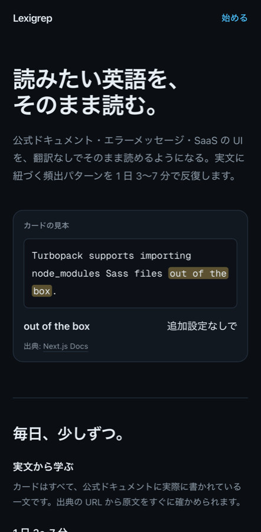
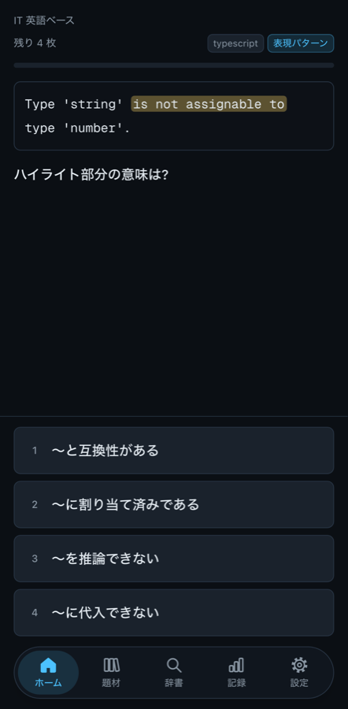
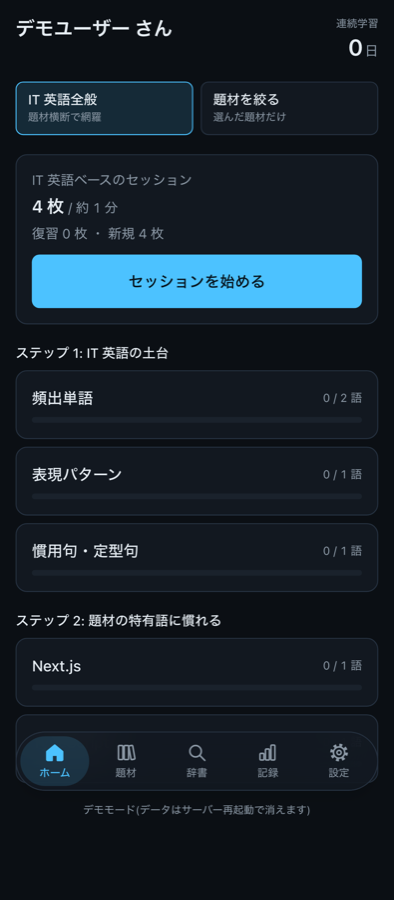

# Lexigrep

[](https://github.com/froggugugugu/Lexigrep/actions/workflows/ci.yml)
[](LICENSE)

英語の公式ドキュメントを**翻訳なしで読めるようになる**ための、間隔反復の学習アプリ。
ドキュメントに実際に書かれている一文をカードにして、1 日 3〜7 分で反復する。日本語話者のエンジニア向け。

<p>
  
  
  
</p>

- **実文から学ぶ** — カードはすべて出典 URL を持つ。作り物の例文は使わない
- **1 日 3〜7 分** — 1 セッション 8〜20 枚。1 カード 1 画面で、答えるとすぐ解説が出る
- **間隔反復(FSRS)** — 覚えたカードは間隔が伸び、まだのカードだけが戻ってくる
- **題材は自分で足せる** — アプリは特定の題材を知らない。読みたいドキュメントの URL からカードを作れる
- **Supabase なしで動く** — clone してすぐ、手元の JSON ファイルに記録を残して使える

同梱の題材は TypeScript / Next.js / Claude Code の 3 つ(計 376 枚)。カードの日本語の意味と解説は AI が下書きしたもので、人のレビューはこれから進める。内容の正確さは保証しない。

## はじめる

Node.js 22 以上と pnpm 10 が必要。

```bash
git clone https://github.com/froggugugugu/Lexigrep.git
cd Lexigrep
pnpm install
LEXIGREP_DATA_SOURCE=local pnpm dev   # http://localhost:3000
```

「デモユーザーで始める」を押すと、認証なしで全機能を使える。学習の記録は `.lexigrep/learning.json` に保存され、再起動しても残る。

| データソース | 起動                                  | 記録の保存先                       |
| ------------ | ------------------------------------- | ---------------------------------- |
| `local`      | `LEXIGREP_DATA_SOURCE=local pnpm dev` | 手元の JSON ファイル               |
| `memory`     | `pnpm dev`(既定)                      | メモリ上(再起動で消える。E2E 用)   |
| `supabase`   | `.env.local` に Supabase の値を設定   | PostgreSQL(Google ログイン、RLS)   |

## 使い方

1. **学習の目的を選ぶ** — ホームで、題材をまたいだ土台を広く学ぶか、題材を 1 つに絞るかを選ぶ
2. **セッションを始める** — 復習の期限が来たカードを先に、残りはまだ学んでいない語句やよく出る語句から出題する
3. **答えて、解説を読む** — 実文 → 設問 → 正誤 → 解説と出典。間違えたカードは同じセッションでもう一度出る
4. **振り返る** — 「記録」で連続日数と定着、「辞書」で語句を題材をまたいで引く

カードは 4 つの層に分かれる: 頻出単語 / 表現パターン / 慣用句・定型句 / 題材特有語。
アプリの中の紹介ページ(`/about`)にも同じ説明がある。

## 自分の題材を追加する

読みたい英語のドキュメントサイトを題材にできる。[Claude Code](https://code.claude.com/docs/en/) でこのリポジトリを開いて、次を実行する。

```text
/author-subject https://example.com/docs/
```

サイトの利用条件の確認 → 雛形の作成 → クロール(robots.txt を尊重)→ 頻度集計 → カードの下書き → 実文の照合までを 1 本で進める。
クロールと引用が題材サイトの利用条件に合うかは、実行する人が確かめる。
できたカードは下書き(draft)なので、自分で 1 枚ずつ確かめてから公開する。

```bash
pnpm content:review <subject>             # 承認 / 修正 / 却下
pnpm content:review <subject> --publish   # 承認したカードを公開
```

skill を使わずに手で進める手順は [docs/development-patterns.md](docs/development-patterns.md) の「コンテンツ執筆」にある。
アプリ名やコース名などの文言は [`site.config.ts`](site.config.ts) で変えられる。

## Supabase で動かす

複数の端末で記録を引き継ぐ場合は Supabase を使う。

1. Supabase のプロジェクトを作り、`supabase/migrations/` を番号順に適用する
2. Google OAuth を有効にし、コールバックに `<サイトの URL>/auth/callback` を登録する
3. `.env.example` を `.env.local` にコピーし、`NEXT_PUBLIC_SUPABASE_URL` と `NEXT_PUBLIC_SUPABASE_PUBLISHABLE_KEY` を設定する
4. `SUPABASE_SERVICE_ROLE_KEY` を設定して `pnpm content:import <subject>` で公開済みのカードを投入する

ホスティングは Vercel を想定している。本番ビルドは `memory` / `local` を既定で拒否する(`LEXIGREP_ALLOW_MEMORY=1` で許可)。

## 開発

```bash
pnpm check    # lint + 型チェック + ユニットテスト
pnpm e2e      # Playwright(memory モードで dev サーバーを自動起動)
pnpm build    # 本番ビルド
```

| コマンド                                     | 内容                                        |
| -------------------------------------------- | ------------------------------------------- |
| `pnpm content:init --subject <id> ...`       | 題材の雛形を作る                            |
| `pnpm content:validate [--write-manifest]`   | 題材パッケージの検証 / manifest 生成        |
| `pnpm pipeline:crawl --subject <id>`         | ドキュメントをクロールしてコーパスを作る    |
| `pnpm pipeline:frequency --subject <id>`     | 語・n-gram の頻度集計                       |
| `pnpm pipeline:author --subject <id> --spec` | 執筆スペックとコーパスからカードを起こす    |
| `pnpm pipeline:verify --subject <id>`        | カードの実文がコーパスに存在するか照合する  |

### 構成

```text
src/app             ルーティング(Next.js App Router)
src/features        機能モジュール(session / srs / dictionary / dashboard / settings / auth / cards)
src/infrastructure  リポジトリ層(memory / local / supabase)
src/shared          コンテンツスキーマ(Zod)・サイト設定・UI 部品
supabase/           マイグレーション(RLS)とそのテスト
content/<subject>   題材パッケージ(subject.json / cards.jsonl / manifest.json)
pipeline/           クロール・頻度集計・カード執筆・照合・レビュー
scripts/            題材の雛形・検証・投入
e2e/                Playwright
docs/               設計ドキュメントと ADR
```

技術スタック: Next.js 16(App Router)/ React 19 / TypeScript / Tailwind CSS 4 / Zod 4 / ts-fsrs / Supabase / Vitest / Playwright。

### ドキュメント

| ファイル                                                     | 内容                                   |
| ------------------------------------------------------------ | -------------------------------------- |
| [docs/project.md](docs/project.md)                           | コマンド、ルーティング、環境変数       |
| [docs/architecture.md](docs/architecture.md)                 | ディレクトリ構成、依存方向、テスト一覧 |
| [docs/data-model.md](docs/data-model.md)                     | スキーマ、テーブル、RLS                |
| [docs/development-patterns.md](docs/development-patterns.md) | コード規約、落とし穴、カードの作り方   |
| [docs/adr/](docs/adr/README.md)                              | 設計判断の記録(ADR)                    |

## クレジット

このプロジェクトは [project-blueprints](https://github.com/froggugugugu/project-blueprints) を利用して開発している。
Claude Code のルール・スキル・エージェント・品質ゲートといった開発の枠組み(`.claude/`、`CLAUDE.md`、`AGENTS.md`)はそこから来ている。
このうち `.claude/skills/author-subject/` は Lexigrep の機能で、題材の追加に使う。
枠組みが読み書きする作業用のファイル(プロジェクト設定、計画、レポート)はリポジトリに含めていない。

## ライセンス

コードは [MIT License](LICENSE)。

`content/` のカードに含まれる英語の実文は、各ドキュメントからの文単位の引用で、権利はそれぞれの権利者にある。
出典と各ドキュメントのライセンスは [content/NOTICE.md](content/NOTICE.md)、同梱するフォントなどは [THIRD_PARTY_NOTICES.md](THIRD_PARTY_NOTICES.md) を参照。

TypeScript は Microsoft Corporation の、Next.js と Vercel は Vercel, Inc. の、Claude と Claude Code は Anthropic, PBC の、Google は Google LLC の、Supabase は Supabase, Inc. の商標または登録商標。
Lexigrep はこれらの企業・プロジェクトとは関係のない、個人が作っているアプリである。
